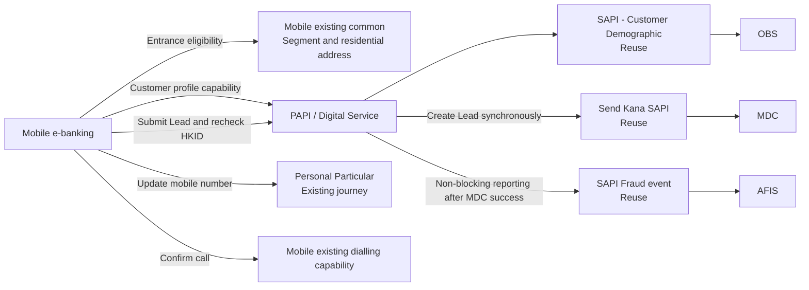

# DCL Lead Form - Solution Design

> Version: Draft v1 | Requirement Source: DCL_NL_Requirement.md (requirement screenshots) | Channel: Mobile e-banking  
> Date: 2026-10-26 | Author: Digital Solution Design

## 0. Function Point Overview

| ID | Function Point | Description | Requirement Evidence |
|---|---|---|---|
| FP-001 | Check DCL function eligibility | Check Lite mode, Segment, residential address, and HKID eligibility at the entrance and page access stages; hide the entrance or display the Error page when the customer is ineligible. | “Customer in below segment cannot see the function”; “Customer cannot see the entrance if his/her residential address is not in Hong Kong”; “The function is not available in lite mode”; “Before the customer reaches the input page, if the customer ID type is not HKID, the system displays an error page” |
| FP-002 | View and complete the DCL Lead form | The customer accesses the Input page, reviews the application guide and prefilled information, enters an optional amount, and selects a preferred contact time. | “After login mobile app, customer can see landing page... customer can access DCL form input page by clicking Debt Consolidation Loan if customer is an HKID customer.”; “Loan amount to settle other debt (Optional)”; “Preferred time of contact value” |
| FP-003 | View the Key Facts Statement | The customer clicks the KFS link and reviews the PDF. | “When customer clicks, then system will show a PDF for review” |
| FP-004 | Navigate to update the contact mobile number | Through the Edit mobile overlay, the customer can either cancel the update and return to the form, or proceed to the Personal Particular journey to update the mobile number. | “Customer click the Edit mobile button. The System display the Updating mobile overlay”; “When clicked, customer can go back to DCL form input page”; “When clicked, customer can go to personal particular landing page” |
| FP-005 | Submit a DCL Lead and view the acknowledgement | After consenting to follow-up contact, the customer submits the Lead; the system creates the Lead, generates a Reference number, and displays the Acknowledgement page. | “When customer clicks continue button and all validation passes, customer will go to acknowledgement page”; “Reference number value... Prefilled and generated by system when customer access acknowledgement page”; “The value is brought from input page and prefilled by system” |
| FP-006 | Request an immediate call to the bank | The customer confirms a call through Call us now, or cancels and returns to the form. | “When the customer clicks, show a click-to-call modal”; “When the customer confirms, initiate a call to...”; “When the customer cancels, close the modal and remain on the DCL form input page, preserving the existing input and selections.” |

## 1. E2E Flow Diagram

## 2. Function Point Details

### FP-001 Check DCL function eligibility

- **Party Responsibilities**:
  - Mobile:
    - Provide the Debt Consolidation Loan entrance under Personal Loans / Loan Application on Mobile e-banking landing.
    - Do not provide this function in Lite mode.
    - Reuse the existing common method to obtain Segment and residential address; hide the entrance when the customer belongs to a blocked segment or the residential address is outside Hong Kong.
    - Blocked segments: BIA Junior under 18, Sole Proprietor, PIB Lite, MPF Only, WMC Southbound Account Only, and Persons With Intellectual Disabilities.
    - Hide the DCL entrance whenever Segment or residential address retrieval fails or returns an unknown result.
    - After the customer clicks the entrance, do not allow access to the Input page until the customer profile has been retrieved and the HKID type confirmed; display Page 4 Error page for non-HKID customers, or when the HKID type is blank or unrecognisable.
  - API: Provide the customer profile capability and return the current customer's name, masked mobile number, and HKID type so Mobile can perform the page access check.
  - AEM: Not involved.
- **B/E Dependencies**: Reuse **SAPI – Customer Demographic** to obtain the HKID type from **OBS**. Retrieval of Segment and residential address information is outside the scope of this requirement.
- **Solution Decisions**:
  - Consolidate the eligibility checks for the same entrance; hide the entrance for Segment/address exceptions and display the Error page for HKID exceptions.
  - Page 4 has no navigation-back option. The customer can click the customer service number to call the bank; the number is configured with the Mobile release.
  - PAPI also revalidates HKID eligibility during Lead submission, as detailed in FP-005.

### FP-002 View and complete the DCL Lead form

- **Party Responsibilities**:
  - Mobile:
    - Display the Input page after the customer profile capability succeeds; show the title, application guide, name, masked mobile number, optional amount, Preferred time, Consent, and other notes.
    - Allow the amount to be blank. When entered, accept numeric values only, with at most two decimal places, within **HKD 60,000–3,000,000 inclusive**. Display an error beneath the amount field when a non-empty amount is outside this range.
    - Display amounts without grouping separators and without padding decimal places; follow the requirement's formatting examples, such as `1234.12`, `1234.1`, and `1234`.
    - Preferred time is Mandatory, with options Anytime, 9:00–12:00, 12:00–15:00, and 15:00–18:00; the default is Anytime.
    - Prefill the name from Customer Demographic. A blank name is not treated as an exception and does not block the journey.
    - Keep the mobile number blank when it is unavailable and do not display the literal text `null`; disable Continue and display a message beneath the mobile number field directing the customer to the PP flow.
    - If the Customer Demographic call fails or times out, do not allow access to the Input page; display Page 4 Error page directly.
    - When the customer re-enters DCL, including after the App is closed mid-journey, do not retain unsubmitted input: retrieve the customer profile again, leave the amount blank, and reset Preferred time to Anytime.
  - API:
    - Provide a standalone customer profile capability, separate from Lead submission.
    - Call Customer Demographic to obtain the name, original mobile number, and HKID type; **PAPI masks the mobile number**, while Mobile only displays the masked result.
    - Return explicit failure semantics to Mobile when the service fails, so Mobile can navigate to Page 4.
  - AEM: Not involved.
- **B/E Dependencies**: Reuse **SAPI – Customer Demographic** to obtain the name, mobile number, and HKID type from **OBS**.
- **Solution Decisions**:
  - Separate customer profile retrieval and Lead submission into two PAPI capabilities to decouple page initialisation from submission.
  - Apply different handling to missing information rather than blocking every case: service failure/HKID exceptions block the journey; a blank name is allowed; a blank mobile number still allows the form to be displayed but prevents submission from Mobile.
  - Release static page wording with Mobile, without introducing AEM, BDE, or CxAPI content dependencies.

### FP-003 View the Key Facts Statement

- **Party Responsibilities**:
  - Mobile: Provide the KFS hyperlink on the Input page; open the corresponding PDF for review when the customer clicks it.
  - API: Not involved. The KFS PDF is released with Mobile, and no online document retrieval capability is added.
  - AEM: Not involved.
- **B/E Dependencies**: None.
- **Solution Decisions**: Maintain and release KFS content with Mobile. Content updates follow the Mobile release, and no standalone content service is introduced.

### FP-004 Navigate to update the contact mobile number

- **Party Responsibilities**:
  - Mobile:
    - Display the Updating mobile overlay when the customer clicks Edit.
    - On Cancel: close the overlay and return to the DCL Input page, retaining the entered amount, Preferred time, and Consent status.
    - On Update: navigate to the existing Personal Particular landing page. Do not return to DCL automatically; the customer must re-enter DCL after updating the mobile number.
    - Treat re-entry into DCL as a new journey and do not retain previously unsubmitted input.
  - API: No PAPI capability is added or changed for this function point.
  - AEM: Not involved.
- **B/E Dependencies**: Existing Personal Particular journey; its internal profile update implementation is outside the scope of this requirement.
- **Solution Decisions**: Reuse Personal Particular rather than embedding mobile number editing within DCL. Cancelling retains the form state, while leaving DCL does not retain a draft.

### FP-005 Submit a DCL Lead and view the acknowledgement

- **Party Responsibilities**:
  - Mobile:
    - Before Continue, check that the mobile number is present, the amount passes validation, Preferred time is selected, and Consent is ticked.
    - Display an inline error if the customer clicks Continue without ticking Consent; allow the customer to proceed only after it is ticked.
    - Disable Continue during submission to prevent double submission caused by repeated taps.
    - Mobile records the Footprint log as evidence for investigating customer actions and Consent-click traces in legitimate App requests.
    - On successful submission, display the Acknowledgement page with the Reference number, success message, amount, masked mobile number, and Preferred time; Back to home returns to Mobile landing page.
    - Populate the ACK amount from the current submission. If no amount was entered, retain the label and leave its value blank; do not substitute zero or another default. Use the PAPI-masked mobile number and the Preferred time selected for the current submission.
    - If MDC Lead creation fails or times out, navigate to Page 4 Error page. Reuse the “System message / Please call / Contact number” layout, with no navigation-back option; the customer can call customer service.
  - API:
    - Provide a standalone Lead submission capability, separate from the page's customer profile capability.
    - Revalidate HKID eligibility on the server side and perform final validation of the amount and Preferred time. A blank amount is allowed; a non-empty amount follows the same numeric and range rules as the requirement.
    - Do not reject a direct request solely because the mobile number is blank; still send it to MDC for downstream handling.
    - Mobile alone ensures that the customer reads and ticks Consent. The request contains no Consent field, and neither PAPI nor MDC validates Consent.
    - Call Send Kana SAPI synchronously to send the Lead to MDC. MDC creates the record and returns the Reference number for the submission. The main synchronous chain must complete within the API Gateway **24-second** limit.
    - **Do not deduplicate requests**: Mobile prevents repeated taps, but if Mobile is bypassed and two valid requests are generated, PAPI creates two Leads in MDC, with a different Reference number for each submission.
    - Only after MDC succeeds does PAPI reuse SAPI Fraud event to report to AFIS; AFIS reporting does not block the ACK.
    - If AFIS reporting fails or times out, still return the result required for the ACK normally. PAPI records a log and performs subsequent compensation.
  - AEM: Not involved.
- **B/E Dependencies**:
  - Reuse **Send Kana SAPI → MDC**: synchronously create the DCL Lead, receive the required information such as the amount, contact details, and Preferred time, and return the Reference number.
  - Reuse **SAPI Fraud event → AFIS**: receive the Fraud event only after MDC succeeds.
  - Reuse **SAPI – Customer Demographic → OBS**: support PAPI's HKID eligibility recheck during submission.
- **Solution Decisions**:
  - Create the Lead synchronously rather than accepting it asynchronously because the customer needs the Reference number immediately.
  - Send Kana/MDC has been confirmed to complete within 24 seconds. Existing PAPI, Send Kana, and MDC capacity can be reused directly, with no scaling or dedicated isolation required.
  - If the Lead has been created but AFIS reporting fails, do not ask the customer to resubmit. Display the ACK normally and handle the partial success through logging and compensation.
  - Confirmed risk acceptance: without PAPI deduplication, repeated valid requests that bypass Mobile create multiple Leads; direct requests with a blank mobile number also enter MDC. Both are handled by downstream follow-up.
  - Evidence of Consent for legitimate requests relies on the Mobile Footprint log rather than a Consent field in the submission payload.

### FP-006 Request an immediate call to the bank

- **Party Responsibilities**:
  - Mobile:
    - Display a click-to-call modal when the customer clicks Call us now.
    - After customer confirmation, reuse Mobile's existing dialling capability to open the device's phone application and call the bank customer service number configured with the Mobile release.
    - If the customer cancels, close the modal and remain on the DCL Input page, preserving the existing input and selections.
    - The Contact number on Page 4 also supports click-to-call.
  - API: Not involved; no API is added to retrieve the customer service number.
  - AEM: Not involved.
- **B/E Dependencies**: None.
- **Solution Decisions**: Use the device's existing dialling capability. The customer service number is configured with the Mobile release, and no third-party click-to-call service is introduced.

## 3. Function Point × Party Summary Matrix

| Function Point | Mobile | AEM | API | B/E Dependencies |
|---|---|---|---|---|
| FP-001 Check DCL function eligibility | Lite/Segment/address entrance control; HKID page access check; Error page | — | Customer profile capability; return HKID type | SAPI – Customer Demographic/OBS; Mobile existing common |
| FP-002 View and complete the DCL Lead form | Form, input validation, state reset, blank-data interactions, error display | — | Standalone customer profile capability; mobile number masking; failure semantics | SAPI – Customer Demographic/OBS |
| FP-003 View the Key Facts Statement | Open the KFS PDF released with Mobile | — | — | — |
| FP-004 Navigate to update the contact mobile number | Overlay; retain state on cancellation; navigate to Personal Particular | — | — | Existing Personal Particular journey |
| FP-005 Submit a DCL Lead and view the acknowledgement | Prevent repeated taps; final front-end checks; Footprint log; ACK/Error page | — | HKID/amount/contact-time validation; synchronous Lead creation; return Reference number; non-blocking Fraud event and compensation | Send Kana/MDC; SAPI Fraud event/AFIS; Customer Demographic/OBS |
| FP-006 Request an immediate call to the bank | Click-to-call modal; reuse dialling capability; retain state on cancellation | — | — | — |

## 3.1 Other Impacted Areas

| Check Item | Impact Status | Notes |
|---|---|---|
| Notifications (SMS / Email / Push) | N/A | No SMS, email, or Push notification is included in this requirement. |
| Staff Channels (Call Centre / Branch) | N/A | No new Call Centre CRM or branch journey is involved. Downstream manual follow-up after MDC receives the Lead is part of the existing main-flow follow-up process. |
| Third-party Services (whitelist check required) | N/A | OBS, MDC, and AFIS are internal bank dependencies in this solution. No external third-party service is involved, so the whitelist check is not applicable. |
| Data Downstream (MIS / Regulatory Reporting) | N/A | No new MIS, downstream data feed, or regulatory reporting is included in this requirement. |

## 4. Out of Scope & Open Items

**Out of Scope**: Endpoint decomposition and naming, contract details, field-level decomposition, component selection, and B/E internal implementation; development of Segment and residential address retrieval capabilities; the internal Personal Particular update journey; OBS/MDC/AFIS internal implementation; and the AEM channel.

| # | Open Item | Related FP | Owner | Impact / Blocker Status |
|---|---|---|---|---|
| OI-001 | BA/PO to provide and approve the bank customer service number shared by Call us now and Page 4, for inclusion in the Mobile release configuration. | FP-001, FP-005, FP-006 | BA/PO, Mobile | Affects dialling and the contact information on the Error page; **Release blocker**. |
| OI-002 | Confirm the final release wording and content versions, including “X working days” in the application guide, wording truncated in the requirement screenshots, and the final KFS PDF version. | FP-002, FP-003, FP-005 | BA/PO, Mobile | Affects content acceptance and compliance confirmation; **Release blocker**. |
| OI-003 | Define the target logging system and retention period for the Mobile Footprint log, and whether a log-write failure should block Lead submission. | FP-005 | Mobile, BA/PO | Affects the audit trail for Consent actions and exception semantics; **blocker status to be assessed by Mobile/BA**. |

## 5. Confirmed Key Solution Constraints

1. Two PAPI capabilities: customer profile retrieval and DCL Lead submission.
2. PAPI masks the mobile number; Mobile only displays it.
3. The customer cannot access the Input page when Customer Demographic fails or HKID is blank, unknown, or non-HKID.
4. Hide the DCL entrance when Segment/residential address retrieval fails or returns an unknown result; development of these retrieval capabilities is outside this scope.
5. Send Kana synchronously sends the Lead to MDC and returns the Reference number; the chain is confirmed to complete within 24 seconds.
6. Mobile prevents repeated taps, but PAPI does not deduplicate requests; every valid request creates a separate Lead and Reference number in MDC.
7. No Consent field is transmitted; the Mobile Footprint log provides the operation trail for legitimate requests.
8. Send the Fraud event to AFIS only after MDC succeeds; AFIS does not block the ACK, and failures are logged and compensated.
9. Reuse Page 4 for both submission failure and customer profile service failure; provide no navigation-back option and only provide the customer service number.
10. Release page wording, the KFS PDF, and the customer service number with Mobile; neither AEM nor third-party services are involved.
