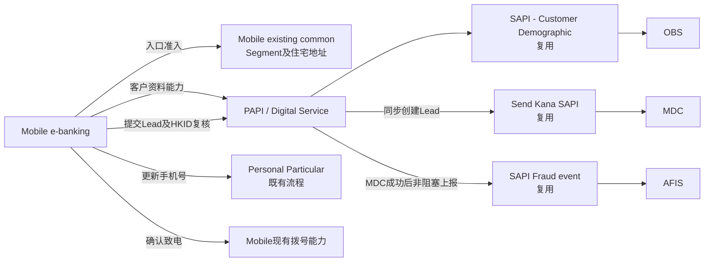

# DCL Lead Form - Solution Design

> 版本：Draft v1 ｜ 需求来源：DCL_NL_Requirement.md（需求截图）｜ 渠道：Mobile e-banking  
> 日期：2026-10-26 ｜ 作者：Digital Solution Design

## 0. 功能点总览

| 编号 | 功能点 | 功能点描述 | 原文依据 |
|---|---|---|---|
| FP-001 | 检查 DCL 功能准入 | 在入口及页面访问阶段检查 Lite mode、Segment、住宅地址和 HKID 资格；不符合条件时隐藏入口或展示 Error page。 | “Customer in below segment cannot see the function”；“Customer cannot see the entrance if his/her residential address is not in Hong Kong”；“The function is not available in lite mode”；“Before the customer reaches the input page, if the customer ID type is not HKID, the system displays an error page” |
| FP-002 | 查看并填写 DCL Lead 表单 | 客户进入 Input page，查看申请指引及预填资料，填写可选金额并选择联系时间。 | “After login mobile app, customer can see landing page... customer can access DCL form input page by clicking Debt Consolidation Loan if customer is an HKID customer.”；“Loan amount to settle other debt (Optional)”；“Preferred time of contact value” |
| FP-003 | 查看 Key Facts Statement | 客户点击 KFS 链接并查阅 PDF。 | “When customer clicks, then system will show a PDF for review” |
| FP-004 | 前往更新联系手机号 | 客户通过 Edit mobile overlay 取消修改并返回表单，或前往 Personal Particular 流程更新手机号。 | “Customer click the Edit mobile button. The System display the Updating mobile overlay”；“When clicked, customer can go back to DCL form input page”；“When clicked, customer can go to personal particular landing page” |
| FP-005 | 提交 DCL Lead 并查看确认 | 客户同意跟进授权后提交 Lead；系统创建 Lead、生成 Reference number，并展示 Acknowledgement page。 | “When customer clicks continue button and all validation passes, customer will go to acknowledgement page”；“Reference number value... Prefilled and generated by system when customer access acknowledgement page”；“The value is brought from input page and prefilled by system” |
| FP-006 | 请求立即致电银行 | 客户通过 Call us now 确认拨号，或取消并返回表单。 | “When the customer clicks, show a click-to-call modal”；“When the customer confirms, initiate a call to...”；“When the customer cancels, close the modal and remain on the DCL form input page, preserving the existing input and selections.” |

## 1. E2E 链路图

## 2. 功能点详情

### FP-001 检查 DCL 功能准入

- **Party 职责**：
  - Mobile：
    - 在 Mobile e-banking landing 的 Personal Loans / Loan Application 下提供 Debt Consolidation Loan 入口。
    - Lite mode 不提供该功能。
    - 复用 existing common 方法取得 Segment 及住宅地址；命中 blocked segments 或住宅地址不在香港时隐藏入口。
    - Blocked segments：BIA Junior under 18、Sole Proprietor、PIB Lite、MPF Only、WMC Southbound Account Only、Persons With Intellectual Disabilities。
    - Segment 或住宅地址获取失败、结果未知时，一律隐藏 DCL 入口。
    - 客户点击入口后，在取得客户资料并确认 HKID 类型前不得进入 Input page；非 HKID、HKID 类型为空或无法识别时展示 Page 4 Error page。
  - API：提供客户资料能力，返回当前客户的姓名、脱敏手机号及 HKID 类型，供 Mobile 完成页面访问检查。
  - AEM：不涉及。
- **B/E 依赖**：复用 **SAPI – Customer Demographic**，从 **OBS** 获取 HKID 类型；Segment 与住宅地址的资料获取不在本次范围内。
- **Solution 决策**：
  - 同一入口的准入检查合并处理；Segment／地址异常采用“隐藏入口”，HKID 异常采用“Error page”。
  - Page 4 无返回入口，客户可点击客服电话致电；客服电话随 Mobile release 配置。
  - PAPI 在提交 Lead 时还会再次校验 HKID，具体见 FP-005。

### FP-002 查看并填写 DCL Lead 表单

- **Party 职责**：
  - Mobile：
    - 调用客户资料能力成功后展示 Input page；展示标题、申请指引、姓名、脱敏手机号、可选金额、Preferred time、Consent 及其他说明。
    - 金额允许留空；非空时仅接受数字、最多两位小数，且须在 **HKD 60,000–3,000,000（含边界）**内。非空金额超出范围时在金额栏下方显示错误。
    - 金额展示不使用 grouping separators，不补齐小数位；有效展示示例沿用需求规则，例如 `1234.12`、`1234.1`、`1234`。
    - Preferred time 为 Mandatory，选项为 Anytime、9:00–12:00、12:00–15:00、15:00–18:00，默认 Anytime。
    - 姓名由 Customer Demographic 预填；姓名为空不视为异常，不阻断流程。
    - 手机号为空时保持空白，不显示字面量 `null`；禁用 Continue，并在手机号栏下方提示客户前往 PP flow。
    - Customer Demographic 调用失败或超时时不得进入 Input page，直接展示 Page 4 Error page。
    - 重新进入 DCL 或 App 中途关闭后重进时，不保留未提交输入：重新取得客户资料、金额空白、Preferred time 恢复 Anytime。
  - API：
    - 提供独立的客户资料能力，不负责 Lead 提交。
    - 调用 Customer Demographic 取得姓名、原始手机号和 HKID 类型；由 **PAPI 完成手机号脱敏**，Mobile 仅展示脱敏结果。
    - 服务失败时向 Mobile 返回明确失败语义，由 Mobile 跳转 Page 4。
  - AEM：不涉及。
- **B/E 依赖**：复用 **SAPI – Customer Demographic**，从 **OBS** 获取姓名、手机号及 HKID 类型。
- **Solution 决策**：
  - 客户资料与 Lead 提交拆成两个 PAPI 能力，避免页面初始化和提交行为耦合。
  - 资料缺失不采用统一阻断：服务失败／HKID 异常阻断；姓名为空放行；手机号为空允许展示表单但禁止从 Mobile 提交。
  - 页面固定文案随 Mobile release 发布，不新增 AEM、BDE 或 CxAPI 内容依赖。

### FP-003 查看 Key Facts Statement

- **Party 职责**：
  - Mobile：在 Input page 提供 KFS hyperlink；客户点击后打开对应 PDF 供查阅。
  - API：不涉及；KFS PDF 随 Mobile release 发布，不新增在线取件能力。
  - AEM：不涉及。
- **B/E 依赖**：无。
- **Solution 决策**：KFS 内容更新跟随 Mobile release，由 Mobile 维护发布内容，不引入独立内容服务。

### FP-004 前往更新联系手机号

- **Party 职责**：
  - Mobile：
    - 客户点击 Edit 后展示 Updating mobile overlay。
    - 点击 Cancel：关闭 overlay 并返回 DCL Input page，保留已填写金额、Preferred time 和 Consent 状态。
    - 点击 Update：跳转既有 Personal Particular landing page；不自动返回 DCL，客户更新后需重新进入 DCL。
    - 客户重新进入 DCL 时按新流程处理，不保留此前未提交输入。
  - API：本功能点不新增或修改 PAPI 能力。
  - AEM：不涉及。
- **B/E 依赖**：Personal Particular 既有流程；其内部资料更新实现不在本次范围内。
- **Solution 决策**：复用 Personal Particular，而非在 DCL 内嵌手机号编辑；取消操作保留表单状态，离开 DCL 后不保留草稿。

### FP-005 提交 DCL Lead 并查看确认

- **Party 职责**：
  - Mobile：
    - Continue 前检查：手机号非空、金额规则通过、Preferred time 已选择、Consent 已勾选。
    - Consent 未勾选且客户点击 Continue 时展示 inline error；勾选后才允许进入下一步。
    - 提交期间禁用 Continue，防止客户连点造成双重提交。
    - 由 Mobile 记录 Footprint log，作为正规 App 请求中客户操作及 Consent 点击轨迹的排查依据。
    - 提交成功：展示 Acknowledgement page，包括 Reference number、成功提示、金额、脱敏手机号和 Preferred time；Back to home 返回 Mobile landing page。
    - ACK 金额来自本次提交值；未填写金额时保留标签并将值留空，不替换为 0 或其他默认值。手机号沿用 PAPI 脱敏结果，Preferred time 使用本次选择值。
    - MDC 创建 Lead 失败或超时：跳转 Page 4 Error page；复用“System message / Please call / Contact number”版面，无返回入口，客户可致电客服。
  - API：
    - 提供独立的 Lead 提交能力；与页面客户资料能力分开。
    - 服务端再次校验 HKID 资格，并对金额及 Preferred time 做最终校验；金额为空允许通过，非空时采用与需求一致的数值及范围规则。
    - 不因手机号为空而拒绝直接请求；仍发送至 MDC，由后方系统处理。
    - Consent 仅由 Mobile 保证客户阅读并勾选；请求中没有 Consent 字段，PAPI／MDC 不校验 Consent。
    - 同步调用 Send Kana SAPI，将 Lead 发送至 MDC；MDC 创建记录并返回本次 Reference number，主同步链路须在 API Gateway **24 秒**限制内完成。
    - **不做请求去重**：Mobile 已做防连点；若绕过 Mobile 并产生两次有效请求，PAPI 会向 MDC 创建两条 Lead，每次提交生成不同 Reference number。
    - MDC 成功后，PAPI 才复用 SAPI Fraud event 向 AFIS 上报；AFIS 上报不阻塞 ACK。
    - AFIS 失败或超时时仍正常返回 ACK 所需结果，由 PAPI 记录日志并后续补偿。
  - AEM：不涉及。
- **B/E 依赖**：
  - 复用 **Send Kana SAPI → MDC**：同步创建 DCL Lead，接收金额、联系资料及 Preferred time 等所需信息，返回 Reference number。
  - 复用 **SAPI Fraud event → AFIS**：仅在 MDC 成功后接收 Fraud event。
  - 复用 **SAPI – Customer Demographic → OBS**：支持 PAPI 在提交时复核 HKID 资格。
- **Solution 决策**：
  - 客户需要立即获得 Reference number，因此采用同步创建 Lead，而非异步受理。
  - Send Kana／MDC 已确认可在 24 秒内完成；现有 PAPI、Send Kana、MDC 容量可直接复用，无需扩容或独立隔离。
  - Lead 已创建但 AFIS 失败时不让客户重复提交，正常展示 ACK，并采用日志与补偿处理部分成功。
  - 已确认的风险接受：无 PAPI 防重时，绕过 Mobile 的重复有效请求会生成多条 Lead；空手机号的直接请求也会进入 MDC，均由后方系统跟进处理。
  - 正规请求的 Consent 证明依赖 Mobile Footprint log，而非提交报文中的 Consent 字段。

### FP-006 请求立即致电银行

- **Party 职责**：
  - Mobile：
    - 客户点击 Call us now 后展示 click-to-call modal。
    - 客户确认后，复用 Mobile 现有拨号能力调起系统电话应用，拨打随 Mobile release 配置的银行客服电话。
    - 客户取消后关闭 modal 并停留在 DCL Input page，保留现有输入和选择。
    - Page 4 的 Contact number 同样支持点击致电。
  - API：不涉及；不新增获取客服电话的 API。
  - AEM：不涉及。
- **B/E 依赖**：无。
- **Solution 决策**：采用设备现有拨号能力，客服电话为 Mobile release 配置，不引入第三方点击通话服务。

## 3. 功能点 × Party 汇总矩阵

| Function Point | Mobile | AEM | API | B/E 依赖 |
|---|---|---|---|---|
| FP-001 检查 DCL 功能准入 | Lite／Segment／地址入口控制；HKID 页面访问检查；Error page | — | 客户资料能力；返回 HKID 类型 | SAPI – Customer Demographic／OBS；Mobile existing common |
| FP-002 查看并填写 DCL Lead 表单 | 表单、输入校验、状态重置、空资料交互、错误展示 | — | 独立客户资料能力；手机号脱敏；失败语义 | SAPI – Customer Demographic／OBS |
| FP-003 查看 Key Facts Statement | 打开随 release 发布的 KFS PDF | — | — | — |
| FP-004 前往更新联系手机号 | Overlay；取消保留状态；跳转 Personal Particular | — | — | Personal Particular 既有流程 |
| FP-005 提交 DCL Lead 并查看确认 | 防连点；最终前端检查；Footprint log；ACK／Error page | — | HKID／金额／联系时间校验；同步创建 Lead；返回 Reference number；非阻塞 Fraud event 与补偿 | Send Kana／MDC；SAPI Fraud event／AFIS；Customer Demographic／OBS |
| FP-006 请求立即致电银行 | Click-to-call modal；复用拨号能力；取消保留状态 | — | — | — |

## 3.1 其他涉及范围（Other Impacted Areas）

| 检查项 | 是否涉及 | 说明 |
|---|---|---|
| Notifications（SMS / Email / Push） | N/A | 已确认本次无短信、邮件或 Push 通知。 |
| Staff Channels（Call Centre / Branch） | N/A | 不涉及新增客服 CRM 或分行流程；MDC 接收 Lead 后的后方人工回访属于既定主链路后续处理。 |
| Third-party Services（须查白名单） | N/A | OBS、MDC、AFIS 均为本方案银行内部依赖；已确认无银行外部第三方服务，白名单检查不适用。 |
| Data Downstream（MIS / 监管报送） | N/A | 已确认本次无新增 MIS、数据下游或监管报送。 |

## 4. Out of Scope & Open Items

**Out of Scope**：endpoint 划分与命名、契约细节、字段级细拆、component 选型、B/E 内部实现；Segment 与住宅地址资料获取能力建设；Personal Particular 内部更新流程；OBS／MDC／AFIS 内部实现；AEM 渠道。

| # | Open Item | 关联 FP | Owner | 影响 / 是否 blocker |
|---|---|---|---|---|
| OI-001 | BA/PO 提供并核准 Call us now 与 Page 4 共用的银行客服电话，随后纳入 Mobile release 配置。 | FP-001、FP-005、FP-006 | BA/PO、Mobile | 影响拨号及 Error page 联系信息；**Release blocker**。 |
| OI-002 | 确认最终发布文案及内容版本，包括申请指引中的“X working days”、需求截图中被截断的文案，以及 KFS PDF 最终版本。 | FP-002、FP-003、FP-005 | BA/PO、Mobile | 影响内容验收与合规确认；**Release blocker**。 |
| OI-003 | 明确 Mobile Footprint log 的目标日志系统、保留期限，以及日志写入失败时是否阻断 Lead 提交。 | FP-005 | Mobile、BA/PO | 影响 Consent 操作轨迹审计与异常语义；**是否 blocker 待 Mobile／BA 评估**。 |

## 5. 已确认的关键方案约束

1. 两个 PAPI 能力：客户资料查询、DCL Lead 提交。
2. PAPI 脱敏手机号；Mobile 只负责展示。
3. Customer Demographic 失败、HKID 为空／未知／非 HKID，均不得进入 Input page。
4. Segment／住宅地址获取失败或未知时隐藏 DCL 入口；其资料获取能力不在本次范围。
5. Lead 由 Send Kana 同步发送至 MDC，并返回 Reference number；链路确保在 24 秒内完成。
6. Mobile 防连点，但 PAPI 不去重；每个有效请求均在 MDC 创建独立 Lead 和 Reference number。
7. Consent 不下传字段；正规请求的操作轨迹由 Mobile Footprint log 证明。
8. MDC 成功后才向 AFIS 发送 Fraud event；AFIS 不阻塞 ACK，失败记录日志并补偿。
9. 提交失败及客户资料服务失败均复用 Page 4；无返回入口，仅提供客服电话。
10. 页面文案、KFS PDF 和客服电话均随 Mobile release 发布；不涉及 AEM 或第三方服务。
